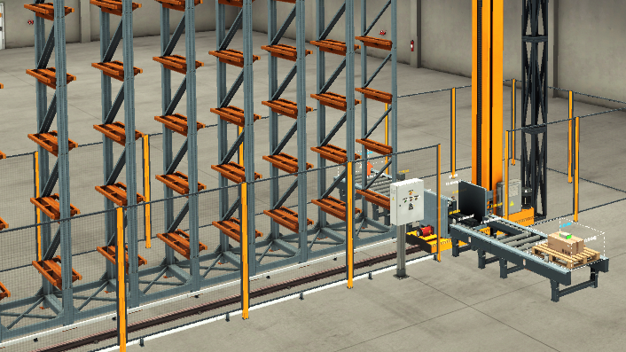
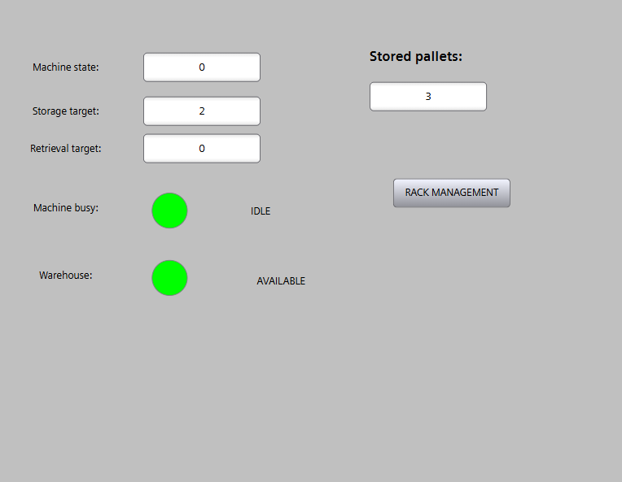
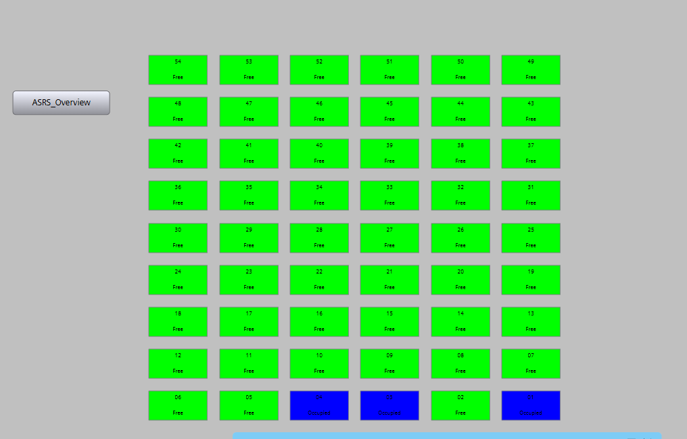
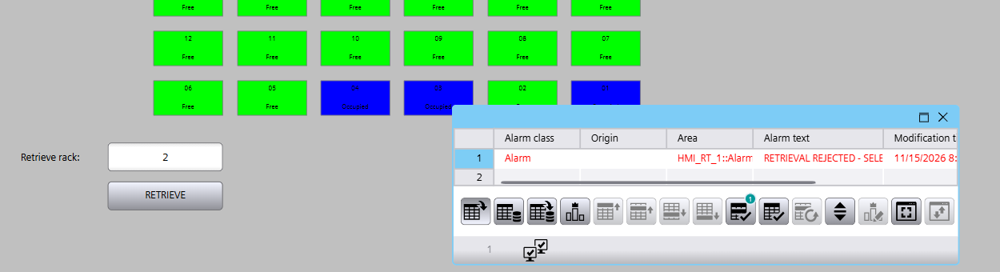
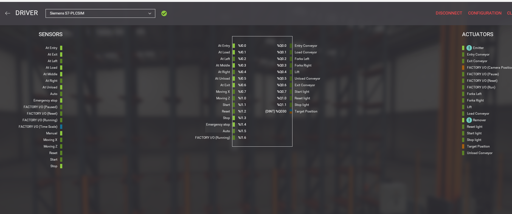

# Smart AS/RS Virtual Commissioning

Virtual commissioning of an **Automated Storage and Retrieval System (AS/RS)** using Siemens TIA Portal, S7-PLCSIM Advanced, Factory I/O and WinCC Unified.

The project controls an automated warehouse with 54 rack locations. The PLC stores incoming pallets in the first available rack, keeps track of warehouse occupancy, retrieves a pallet selected by the operator from WinCC, and reports the current machine and warehouse status back to the HMI.



## Main technologies

- Siemens TIA Portal V21
- SIMATIC S7-1500 — CPU 1511-1 PN
- S7-SCL
- S7-PLCSIM Advanced V8
- Factory I/O v2.5.5
- WinCC Unified PC Runtime

## What the project does

- Automatic pallet storage
- First-free-rack selection across 54 locations
- Rack occupancy tracking with a Boolean array
- Automatic retrieval from an operator-selected rack
- Stored-pallet counter
- Warehouse-full detection
- Machine-state monitoring
- WinCC overview and rack-management screens
- Reusable rack-cell faceplate for all 54 locations
- Retrieval rejection when a selected rack is empty
- WinCC discrete alarm and acknowledgment
- Full PLC ↔ PLCSIM Advanced ↔ Factory I/O ↔ WinCC integration

## Control architecture

The PLC keeps control authority over the process. WinCC is used for supervision and operator commands, while Factory I/O represents the virtual machine.

```text
WinCC Unified
    │
    │ commands / status / alarms
    ▼
S7-1500 PLC logic in TIA Portal
    │
    │ digital I/O + numerical position command
    ▼
S7-PLCSIM Advanced
    │
    ▼
Factory I/O AS/RS plant
```

The main automatic logic is implemented in `FB_ASRS_Auto` using a step-based state machine.

## PLC sequence concept

A static `Step` variable controls the sequence:

```scl
CASE #Step OF
    0:   // IDLE / request handling
    10:  // Feed pallet
    20:  // Move pallet to load station
    ...
    160: // Storage complete

    200: // Start retrieval
    ...
    340: // Retrieval complete
END_CASE;
```

I used this structure because every mechanical action has a clear state and a clear transition condition. It also makes commissioning easier because the active state can be monitored from the HMI.

The internal `Step` value is copied to a public FB output called `State`, which is what WinCC reads for machine-state supervision.

## Warehouse occupancy management

The warehouse has 54 rack locations. Their status is stored in an array:

```scl
Occupied[1..54] : Array[1..54] of Bool;
```

- `FALSE` = rack free
- `TRUE` = rack occupied

Before a storage cycle, the PLC searches for the first free rack:

```scl
#FreeSlotFound := FALSE;

FOR #SearchIndex := 1 TO 54 DO
    IF NOT #Occupied[#SearchIndex] THEN
        #StorageTarget := INT_TO_DINT(#SearchIndex);
        #FreeSlotFound := TRUE;
        EXIT;
    END_IF;
END_FOR;
```

After the pallet is successfully stored, the selected position is marked occupied and the stored-pallet counter is incremented.

## Why `StorageTarget` and `TargetPosition` are separate

`StorageTarget` is warehouse memory: it remembers **which rack was selected for the pallet**.

`TargetPosition` is the current movement command sent to the Factory I/O crane.

For example, a pallet may be stored in rack 4:

```scl
#StorageTarget := 4;
#TargetPosition := #StorageTarget;
```

After the pallet is deposited, the crane is sent home:

```scl
#TargetPosition := 55;
```

`StorageTarget` still remains 4, so the PLC can update the correct rack in the inventory array.

## Retrieval from WinCC

The operator enters a rack number on the Rack Management screen and presses **RETRIEVE**.

The PLC accepts the request only if the position is valid and the selected rack is occupied.

```scl
IF #RetrieveRequest AND NOT #RetrieveRequestPrev THEN
    IF (#RetrievePosition >= 1) AND (#RetrievePosition <= 54) THEN
        IF #Occupied[#RetrievePosition] THEN
            #RetrievalTarget := #RetrievePosition;
            #Step := 200;
        END_IF;
    END_IF;
END_IF;
```

`RetrievalTarget` is latched so the requested rack remains known during the complete retrieval sequence.

## WinCC Unified overview



The overview screen shows:

- Machine state
- Current storage target
- Current retrieval target
- Number of stored pallets
- IDLE / BUSY indication
- Warehouse AVAILABLE / FULL indication
- Navigation to Rack Management

## Rack Management



The Rack Management screen represents all 54 physical storage locations in the same orientation as the Factory I/O warehouse.

Each rack cell shows:

- Rack number
- Free / Occupied status
- Dynamic color based on occupancy

The cells were implemented using a reusable WinCC Unified faceplate (`FP_RackCell`) rather than 54 independent screen objects.

The HMI array uses indices `0..53`, so the mapping is:

```text
Rack 01 → ASRS_Occupied[0]
Rack 02 → ASRS_Occupied[1]
...
Rack 54 → ASRS_Occupied[53]
```

## Retrieval alarm

If the operator requests a rack that is currently free, the PLC rejects the request and sets `RetrievalRackEmpty`.

WinCC uses that status to generate a discrete alarm.



This part of the project also helped me separate two SCADA concepts:

- **Acknowledge:** the operator confirms the alarm has been seen.
- **PLC reset:** the actual controller condition is cleared.

Acknowledging the alarm does not directly modify the PLC condition.

## Factory I/O communication



The virtual plant exchanges digital sensor and actuator signals with the simulated S7-1500.

Examples:

```text
Inputs
%I0.0   AtEntry
%I0.1   AtLoad
%I0.2   AtLeft
%I0.3   AtMiddle
%I0.4   AtRight
%I0.7   MovingX
%I1.0   MovingZ

Outputs
%Q0.0   Entry Conveyor
%Q0.1   Load Conveyor
%Q0.2   Forks Left
%Q0.3   Forks Right
%Q0.4   Lift
%Q0.5   Unload Conveyor
%Q0.6   Exit Conveyor
```

The crane position command is a DINT mapped at:

```text
%QD30 → Target Position
```

The Factory I/O numerical-output area therefore starts at byte 30.

## Some commissioning details

A few details had to be handled during testing rather than assumed from the beginning:

- The `AtLoad` signal behaves inverted in this Factory I/O scene.
- The Stop and Emergency Stop signals behave as normally-closed signals.
- The storage pickup side and rack interaction side use different fork directions.
- Positions `1..54` are rack locations and `55` is used as the crane home/rest command.
- HMI commands are written to PLC command tags that are then passed into the FB from OB1.
- FB status values are read from the instance DB by WinCC.

These points were found and verified during virtual commissioning.

## Running the project

Typical startup sequence:

1. Open / restore the TIA Portal project in TIA Portal V21.
2. Start an S7-PLCSIM Advanced instance for the CPU.
3. Download the PLC hardware/software and put the CPU in RUN.
4. Open the Factory I/O AS/RS scene.
5. Select the Siemens S7-PLCSIM driver and connect it to the simulated PLC.
6. Start WinCC Unified PC Runtime.
7. Run the Factory I/O scene and test storage / retrieval from the HMI.

For the configuration used during development, the PLCSIM Advanced PLC used IP `192.168.0.10` and the WinCC PC interface used `192.168.0.1`.

## Repository contents

```text
Smart-ASRS-Virtual-Commissioning/
├── README.md
├── screenshots/
│   ├── 01_factoryio_asrs_scene.png
│   ├── 02_wincc_overview.png
│   ├── 03_wincc_rack_management.png
│   ├── 04_wincc_retrieval_alarm.png
│   └── 05_factoryio_io_mapping.png
└── project/
    └── Smart_ASRS_Virtual_Commissioning.zip
```

The `project` directory contains the archived engineering project. The screenshots folder contains only the main views needed to understand the finished system.

## Project scope

This is a virtual commissioning and automation-development project. The focus is PLC sequencing, warehouse logic, HMI/SCADA integration and simulation. It is not presented as a production safety-certified machine application.
